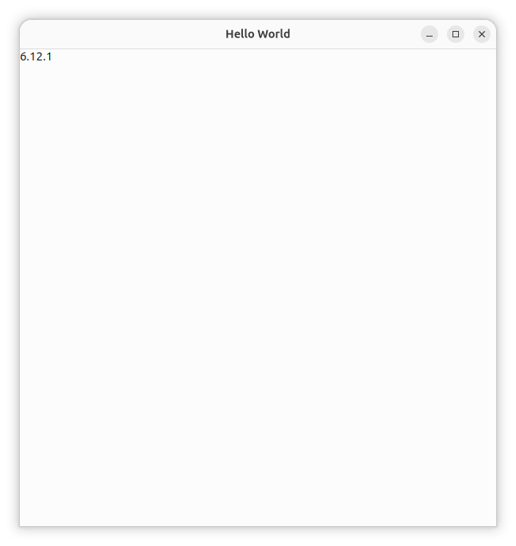
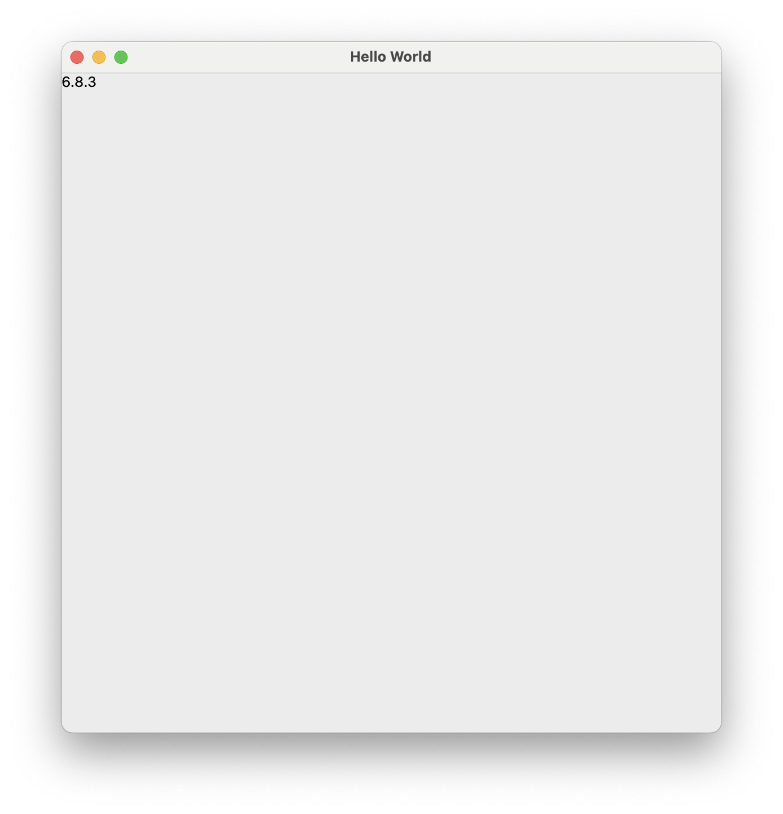

<!--
SPDX-FileCopyrightText: 2022-2025 Julian Amann <dev@vertexwahn.de>
SPDX-License-Identifier: Apache-2.0
-->


[](https://opensource.fb.com/support-ukraine) [](https://bazel.build/) [](https://www.qt.io/product/qt6)

# Bazel rules for Qt6


## Goal 

The goal of these rules is to be able to build [Qt6](https://www.qt.io/product/qt6) applications using [Bazel](https://bazel.build/) on **Linux**, **macOS** and **Windows** without the need to preinstall Qt6. 
All the magic to set up Qt6 should be done by Bazel with as little effort as possible.

## Why rules and not a simple dependency?

To get Qt working with C++, you need different tools, e.g., the Meta-Object Compiler (moc).
This is needed since Qt introduces some language extensions to C++, such as the signal & slot concept.
There is also the User Interface Compiler (uic), Resource Compiler (rcc), and translation tools.
To get all of those things working, Qt is a bit more than a simple third-party dependency.
The idea of this project is to introduce own rules that simplify the usage of Qt using Bazel.

## Current status

These rules require Bazel 8 or newer and are tested with Bazel 9.x and 8.x (see [CI](.github/workflows/bazel_build.yml)).
If you need support for older versions of Bazel, please check out an older state of this repository.
Initially, this repository had support for Bazel 4.x.

When using these rules, a prebuilt version of Qt is fetched from [download.qt.io](https://download.qt.io/) -
only for the platforms that a build needs.
Previously a prebuilt version of Qt was fetched from [vertexwahn.de](https://vertexwahn.de/) (this approach was taken for example in release 0.0.4 of these rules).

Supported Qt versions (only LTS releases):

| Qt version | Notes                                   |
| ---------- | --------------------------------------- |
| 6.12.1     | Default (newest LTS release)            |
| 6.8.3      | Previous LTS release                    |

Supported platforms:

| Platform       | Qt repository       | Requirements                                                                           |
| -------------- | ------------------- | -------------------------------------------------------------------------------------- |
| Linux x86_64   | `qt_linux_x86_64`   | glibc 2.34 or newer (e.g. Ubuntu 24.04+, Debian 12+)                                   |
| Linux aarch64  | `qt_linux_aarch64`  | glibc 2.39 or newer (e.g. Ubuntu 24.04+, Debian 13+)                                   |
| macOS arm64    | `qt_mac_aarch64`    | macOS 14.4 or newer for Qt 6.12.1, macOS 12 or newer for Qt 6.8.3                      |
| macOS x86_64   | `qt_mac_x86_64`     | macOS 14.4 or newer for Qt 6.12.1, macOS 12 or newer for Qt 6.8.3                      |
| Windows x86_64 | `qt_windows_x86_64` | Visual Studio 2022 or newer (MSVC). Only Qt Base, Qt Declarative, Qt SVG and Qt 5 Compat |

On macOS, the Qt frameworks are built for a minimum macOS version (Qt 6.12.1: macOS 14.4).
If you set `--macos_minimum_os`, use this version or a newer one.
Otherwise, the linker warns `building for macOS-..., but linking with dylib '@rpath/QtCore.framework/Versions/A/QtCore' which was built for newer version 14.4`.

Qt 6 requires at least C++17. The default C++ toolchains of Bazel 8 and newer use C++17 on Linux and macOS.
With Visual Studio, you need to set `/std:c++17` (or newer) and `/Zc:__cplusplus` -
the [`.bazelrc`](tests/.bazelrc) of the tests shows the settings that are used to test these rules.

## Usage

Add to your `MODULE.bazel` file:

```starlark
bazel_dep(name = "rules_qt", version = "0.0.8")

# Optional - selects the Qt version (default: the newest supported Qt LTS release)
qt = use_extension("@rules_qt//extension:qt.bzl", "fetch")
qt.install(version = "6.12.1")
```

The Qt toolchains (moc, rcc, and uic) are registered by rules_qt. Use the rules in your `BUILD.bazel` files:

```starlark
load("@rules_qt//:qt.bzl", "qt_cc_binary")

qt_cc_binary(
    name = "hello_world",
    srcs = ["hello_world.cpp"],
    deps = [
        "@rules_qt//:qt_core",
        "@rules_qt//:qt_widgets",
    ],
)
```

Further options of `qt.install`:

- `qt.install(os = "windows", version = "6.8.3")` selects the Qt version for one platform
  (`linux_x86_64`, `linux_aarch64`, `macos`, or `windows`).
- `qt.install(base_urls = ["https://mirror.example.com/qtproject/online/qtsdkrepository/"])` downloads Qt from mirrors of
  https://download.qt.io/online/qtsdkrepository/.
- If you reference the Qt repositories directly in your `BUILD.bazel` files (e.g. `@qt_linux_x86_64//:plugins`),
  add them via `use_repo(qt, "qt_linux_x86_64")`.

Migrating from rules_qt 0.0.7 or older: the former usage
(`qt.install(name = ..., build_file = ..., os = ..., version = ..., windows_architecture = ...)` per platform) still works.
`build_file` values that point to rules_qt (e.g. `@rules_qt//extension:qt/6.8.3/linux_x86_64.BUILD`) are ignored -
you can remove them, as well as `register_toolchains("@rules_qt//tools:all")`.
Own BUILD files (`build_file` outside of rules_qt) still work - on Windows, they should provide a `qt_runtime` target
with the Qt DLLs that Qt plugins need at runtime (an empty one is added otherwise).
moc is now taken from the Qt toolchain like rcc and uic - own toolchains (`qt_toolchain`) have to provide it as well.
The `*_cmd` attributes of `qt_toolchain` are deprecated - use `moc`, `rcc`, and `uic`.

### Adding a new Qt version

The download paths and SHA-256 hashes of the prebuilt Qt archives are generated:

```shell
python3 extension/versions/generate.py 6.12.1
```

Afterwards, add the new version to [`extension/qt_versions.bzl`](extension/qt_versions.bzl)
and to the CI matrix ([`.github/workflows/bazel_build.yml`](.github/workflows/bazel_build.yml)).

## Quick start

This project uses [Bazel](https://bazel.build/) as a build system. 
The current used version of Bazel is defined in [.bazelversion](tests/.bazelversion).

**Prerequisites:**

The following tools should be installed:
- [Git](https://git-scm.com/)
- [Bazel](https://bazel.build/install)
- A C++ compiler (GCC, Visual Studio, Clang, etc.)

On Linux, you also need to install the following system packages, which provide the symbols needed for linking
(the CI installs the same list). Without them, linking fails with errors like
`libEGL.so.1, needed by libQt6Gui.so, not found`:

```shell
sudo apt-get update && \
sudo apt-get install -y  \
  libegl-dev \
  libegl1-mesa-dev \
  libfontconfig1-dev \
  libgl-dev \
  libgl1-mesa-dev \
  libpcsclite-dev \
  libpulse-dev \
  libva-dev \
  libx11-xcb-dev \
  libxcb-cursor-dev \
  libxcb-icccm4-dev \
  libxcb-image0-dev \
  libxcb-keysyms1-dev \
  libxcb-randr0-dev \
  libxcb-render-util0-dev \
  libxcb-shape0-dev \
  libxcb-sync-dev \
  libxcb-xfixes0-dev \
  libxkbcommon-dev \
  libxkbcommon-x11-dev
```

**Checkout, build, and run:**

```shell
git clone https://github.com/Vertexwahn/rules_qt6
cd rules_qt6/tests
bazel run //hello_world:hello_world
```

**Expected output**

The expected output should be similar (depending on your platform) to the following screenshots:

*Windows*


*Ubuntu*



*macOS*



**More Examples**

More examples can be found in the [tests](tests) directory.
## Contributions are welcomed

Any improvements to the Qt6 build experience using Bazel are always welcome.
Maybe you have solved this problem already. 
In this case, 
I would appreciate it if you could share your efforts under some permissive license.
If you name no specific license, I assume you are fine with the current used license of this project (Apache 2.0 License).

## Related projects

| Project                                                                                               | Bzlmod Support | Platform Support      | Build Type  | Last Commit Checked      |
| ----------------------------------------------------------------------------------------------------- | -------------- | --------------------- | ----------- | ----------------- |
| [aabtop/rules_qt](https://github.com/aabtop/rules_qt)                                                 | no             | Windows, Linux        | Prebuild    | June 21, 2021     |
| [bbreslauer/qt-bazel-example](https://github.com/bbreslauer/qt-bazel-example)                         | no             | Linux                 | Prebuild    | April 5, 2020     |
| [FirasRomaneh/QT5WithBazel](https://github.com/FirasRomaneh/QT5WithBazel)                             | no             | Linux                 | Prebuild    | August 2, 2022    |
| [gwkawano/bazel_qt](https://github.com/gwkawano/bazel_qt)                                             | no             | Linux                 | Prebuild    | June 5, 2020      |
| [jheaff1/rules_qt](https://github.com/jheaff1/rules_qt)                                               | no             | Linux, macOS, Windows | Prebuild    | June 19, 2023     |
| [justbuchanan/bazel_rules_qt](https://github.com/justbuchanan/bazel_rules_qt)                         | no             | Linux, macOS, Windows | Prebuild    | November 13, 2024 |
| [kklochkov/rules_qt](https://github.com/kklochkov/rules_qt)                                           | yes            | Linux, macOS          | Prebuild & From Source | July 25, 2026 |
| [The-OpenROAD-Project/qt_bazel_prebuilts](https://github.com/The-OpenROAD-Project/qt_bazel_prebuilts) | yes            | ???                   | From Source | Jul 15, 2025      |

## License

This work is published under Apache 2.0 License.

This work builds on top of [justbuchanan/bazel_rules_qt](https://github.com/justbuchanan/bazel_rules_qt) which is also licensed under Apache 2.0 and 
was forked from [bbreslauer/qt-bazel-example](https://github.com/bbreslauer/qt-bazel-example).
See [here](https://github.com/justbuchanan/bazel_rules_qt/graphs/contributors) for details.

## Thanks to all contributors ❤

 <a href = "https://github.com/Vertexwahn/rules_qt6/graphs/contributors">
   
 </a>

This would not have been possible without all the effort from the contributors of this and the related projects.
Some initial work of the related projects dates back more than ten years by now.
